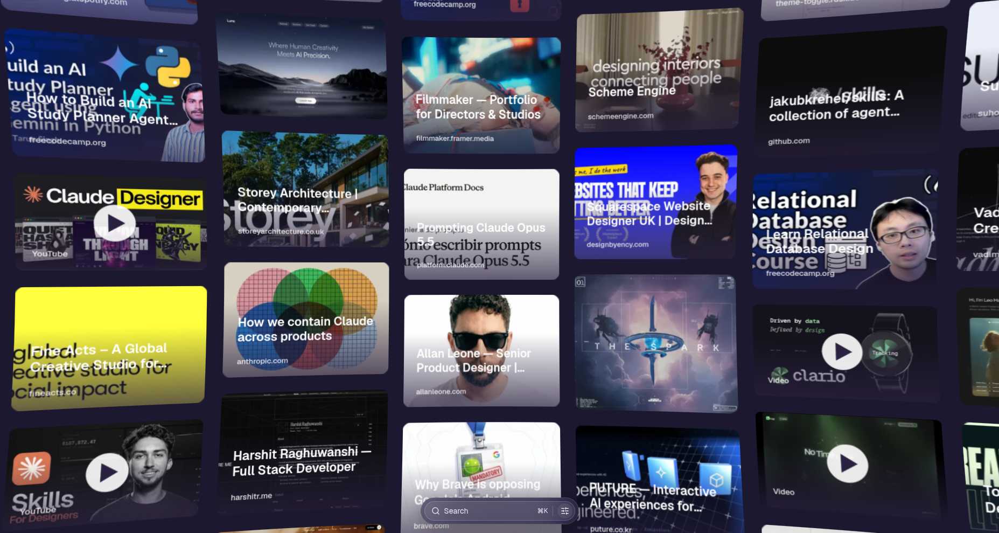
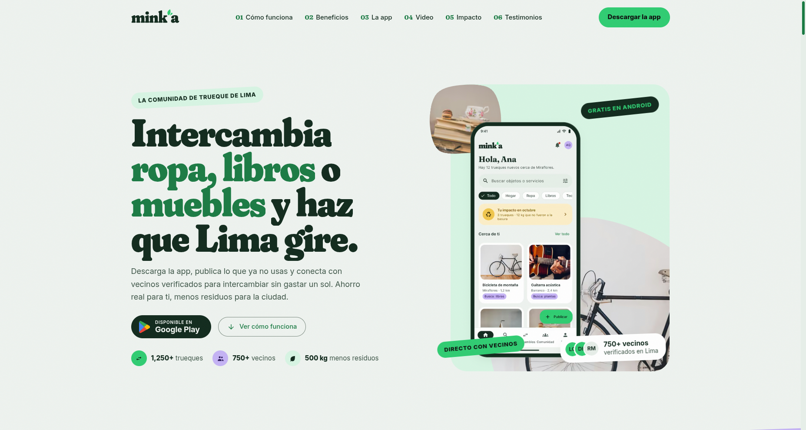

# Hi! I'm Jahat, a design engineer

> I build products people actually use, designed and built by the same person. So nothing gets lost between design and code: it looks right, it works, and it ships sooner.

<!-- markdownlint-disable MD033 -->

  <a href="https://jahattrinidad.com/">
    <picture>
      <source media="(prefers-color-scheme: dark)" srcset="assets/images/portfolio-button/portfolio-button-dark.svg" />
      <source media="(prefers-color-scheme: light)" srcset="assets/images/portfolio-button/portfolio-button-light.svg" />
      
    </picture>
  </a>

<!-- markdownlint-enable MD033 -->

## About Me

<!-- markdownlint-disable MD033 -->
<table>
<tr>
<td width="65%" valign="middle">

**Design engineer, frontend and product.** I take ideas from the first sketch to the live site: interface, motion, code, and the architecture that lets the product keep growing instead of being redone.

I speak both languages: designs engineers can build, and code designers recognize as theirs. Brand work taught me systems, teaching taught me to explain, and running community channels taught me to listen to users. I use all three every time I build, mostly with **TypeScript**, **Astro**, and **React** on the web, and **Kotlin** with **Jetpack Compose** on Android. Software Engineering student at **UPC**.

**Open to an internship, now:** frontend or product design engineering.

- :round_pushpin: **Lima, Peru** · **GMT-5** · **Open to remote**
- :globe_with_meridians: **Languages:** Spanish (native), English (B1), Portuguese (A2)

</td>
<td width="35%" align="center" valign="middle">

<picture>
  <source media="(prefers-color-scheme: dark)" srcset="https://raw.githubusercontent.com/trinity-bytes/trinity-bytes/main/assets/gifs/about-me-coding-dark.gif" />
  <source media="(prefers-color-scheme: light)" srcset="https://raw.githubusercontent.com/trinity-bytes/trinity-bytes/main/assets/gifs/about-me-coding-light.gif" />
  
</picture>

</td>
</tr>
</table>
<!-- markdownlint-enable MD033 -->

## Tech Stack

<!-- markdownlint-disable MD033 -->

**Web**

**Mobile & Backend**

**Foundations & Tools**

<!-- markdownlint-enable MD033 -->

## Stats

<!-- markdownlint-disable MD033 -->

  <picture>
    <source media="(prefers-color-scheme: dark)" srcset="https://pro-github-stats.vercel.app/api?username=trinity-bytes&bg_color=1e1e2e&title_color=cba6f7&text_color=cdd6f4&icon_color=cba6f7&ring_color=cba6f7&hide_border=true&include_all_commits=true&count_private=true" />
    <source media="(prefers-color-scheme: light)" srcset="https://pro-github-stats.vercel.app/api?username=trinity-bytes&bg_color=eff1f5&title_color=8839ef&text_color=4c4f69&icon_color=8839ef&ring_color=8839ef&hide_border=true&include_all_commits=true&count_private=true" />
    
  </picture>
  <picture>
    <source media="(prefers-color-scheme: dark)" srcset="https://pro-github-stats.vercel.app/api/top-langs/?username=trinity-bytes&bg_color=1e1e2e&title_color=cba6f7&text_color=cdd6f4&icon_color=cba6f7&ring_color=cba6f7&hide_border=true&layout=compact" />
    <source media="(prefers-color-scheme: light)" srcset="https://pro-github-stats.vercel.app/api/top-langs/?username=trinity-bytes&bg_color=eff1f5&title_color=8839ef&text_color=4c4f69&icon_color=8839ef&ring_color=8839ef&hide_border=true&layout=compact" />
    
  </picture>

  <picture>
    <source media="(prefers-color-scheme: dark)" srcset="assets/images/starry-night/starry-night-dark.svg" />
    <source media="(prefers-color-scheme: light)" srcset="assets/images/starry-night/starry-night-light.svg" />
    
  </picture>

<!-- markdownlint-enable MD033 -->

## Featured Projects

<!-- markdownlint-disable MD033 -->
<table>
<tr>
<td width="50%" valign="top">

### Inspiration Garden

  

**My Library of References, Open to Anyone**

I kept losing references: a font in a bookmark, a layout in a screenshot, a library somewhere in a chat. So I built one place to save them: images, links, texts, videos, color palettes, and fonts. My AI agents and I save, tag, and sort it through the same API.

- WebGL (three.js) canvas you can travel in every direction, with a barrel lens and budgeted GPU texture uploads
- Search with kind, category, tag, and dominant-color filters; installable PWA built for phones
- Agent-friendly REST API with scoped bearer tokens and an OpenAPI 3.1 spec
- Trash with restore and a revision history for every item

**Tech:** React, Vite, three.js, TypeScript, Cloudflare Workers, Hono, D1, Drizzle, R2, Zod, Vitest

**Role:** Product, design, and code. Solo; first commit to first release in 7 days.

[📂 Repo](https://github.com/trinity-bytes/my-inspiration-garden) - [🌐 Live](https://inspo.jahattrinidad.com/)

</td>
<td width="50%" valign="top">

### Mink'a

  

**Community Bartering & Circular Economy**

A bartering platform for Lima: publish what you no longer use, connect with verified neighbors, and trade without spending money.

- **Landing page:** built with Astro, mobile first, deployed with GitHub Actions
- **Android app:** Kotlin and Jetpack Compose with a feature-based clean architecture (domain, application, infrastructure, presentation) and an in-app Ktor mock API

**Tech:** Astro, TypeScript, Kotlin, Jetpack Compose, Material 3, Ktor, GitHub Actions

**Role:** Core contributor & integration lead. Team of 6, GitFlow.

[📂 Landing](https://github.com/trinity-bytes/minka) - [📱 Android](https://github.com/trinity-bytes/minka-android) - [🌐 Live](https://minka.jahattrinidad.com/)

</td>
</tr>
</table>
<!-- markdownlint-enable MD033 -->

Case studies and more projects on [jahattrinidad.com](https://jahattrinidad.com/work/).

---

<!-- markdownlint-disable MD033 -->

Looking for someone who can design it and build it? Let's talk on <a href="https://www.linkedin.com/in/trinitybytes">LinkedIn</a> or through <a href="https://jahattrinidad.com/">my portfolio</a>.

<!-- markdownlint-enable MD033 -->
