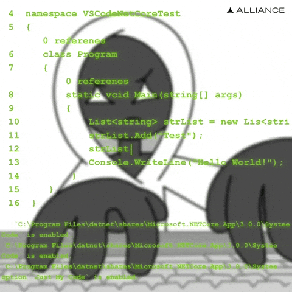
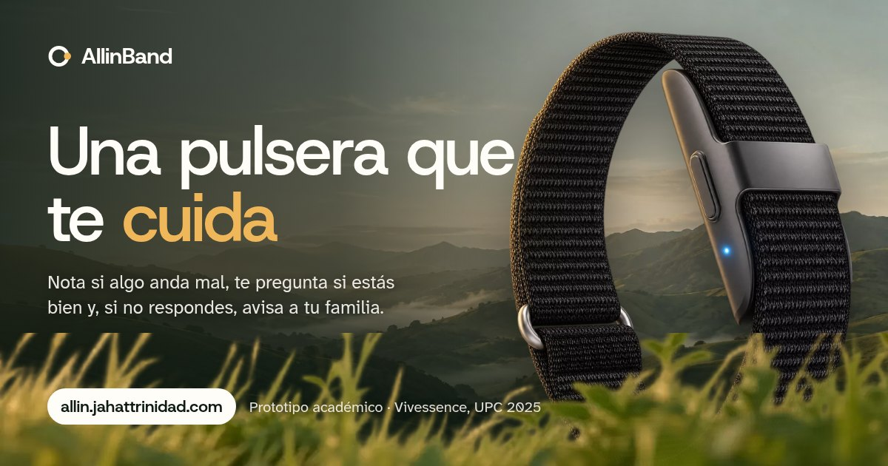
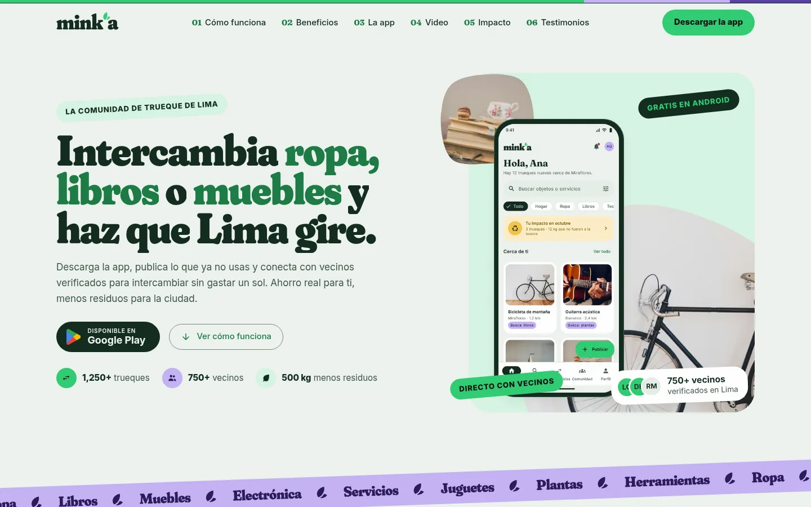

# Hi! I'm Jahat, a software engineer in the making

> I build web and Android products end to end: accessible interfaces, thoughtful motion, and clean architecture underneath.

<!-- markdownlint-disable MD033 -->

  <!-- TODO: uncomment when the portfolio is live
  
  -->

<!-- markdownlint-enable MD033 -->

## About Me

<!-- markdownlint-disable MD033 -->
<table>
<tr>
<td width="65%" valign="middle">

Software Engineering student at **UPC** who enjoys turning ideas into products people can actually use. These days I spend most of my time on **TypeScript** web apps with **Astro** and **React**, and on native **Android** apps with **Kotlin** and **Jetpack Compose**.

I care about accessibility, performance, and code that stays easy to change, so I lean on clean architecture and tests. My roots are in **C++** and algorithms, and I've led a 6-person team using GitFlow and Scrum.

**Currently seeking an internship** where I can ship web or mobile features in a real product team.

- :round_pushpin: **Lima, PE** · **GMT-5** · **Available now**
- :globe_with_meridians: **Languages:** Spanish (native), English (B1), Portuguese (A2)

</td>
<td width="35%" align="center" valign="middle">

<picture>
  <source media="(prefers-color-scheme: dark)" srcset="https://raw.githubusercontent.com/trinity-bytes/trinity-bytes/main/assets/gifs/about-me-coding-dark.gif" />
  <source media="(prefers-color-scheme: light)" srcset="https://raw.githubusercontent.com/trinity-bytes/trinity-bytes/main/assets/gifs/about-me-coding-light.gif" />
  
</picture>

</td>
</tr>
</table>
<!-- markdownlint-enable MD033 -->

## Tech Stack

<!-- markdownlint-disable MD033 -->

**Web**

**Mobile & Backend**

**Foundations & Tools**

<!-- markdownlint-enable MD033 -->

## Stats

<!-- markdownlint-disable MD033 -->

  <picture>
    <source media="(prefers-color-scheme: dark)" srcset="https://pro-github-stats.vercel.app/api?username=trinity-bytes&bg_color=1e1e2e&title_color=cba6f7&text_color=cdd6f4&icon_color=cba6f7&ring_color=cba6f7&hide_border=true&include_all_commits=true&count_private=true" />
    <source media="(prefers-color-scheme: light)" srcset="https://pro-github-stats.vercel.app/api?username=trinity-bytes&bg_color=eff1f5&title_color=8839ef&text_color=4c4f69&icon_color=8839ef&ring_color=8839ef&hide_border=true&include_all_commits=true&count_private=true" />
    
  </picture>
  <picture>
    <source media="(prefers-color-scheme: dark)" srcset="https://pro-github-stats.vercel.app/api/top-langs/?username=trinity-bytes&bg_color=1e1e2e&title_color=cba6f7&text_color=cdd6f4&icon_color=cba6f7&ring_color=cba6f7&hide_border=true&layout=compact" />
    <source media="(prefers-color-scheme: light)" srcset="https://pro-github-stats.vercel.app/api/top-langs/?username=trinity-bytes&bg_color=eff1f5&title_color=8839ef&text_color=4c4f69&icon_color=8839ef&ring_color=8839ef&hide_border=true&layout=compact" />
    
  </picture>

  <picture>
    <source media="(prefers-color-scheme: dark)" srcset="assets/images/starry-night/starry-night-dark.svg" />
    <source media="(prefers-color-scheme: light)" srcset="assets/images/starry-night/starry-night-light.svg" />
    
  </picture>

<!-- markdownlint-enable MD033 -->

## Featured Projects

<!-- markdownlint-disable MD033 -->
<table>
<tr>
<td width="50%" valign="top">

### AllinBand

  

**Smart Wristband for Emergency Detection**

Official landing page for a smart wristband concept that monitors vital signs, asks the wearer if they are okay, and alerts family and a health center if they don't respond.

- Static site with zero dependencies and no build step
- Scroll-driven horizontal journey and pointer-depth hero, animated with `transform`, `opacity`, and SVG strokes only
- Fully readable without JavaScript; respects `prefers-reduced-motion`
- Targets WCAG 2.2 AA; browser tests with Playwright

**Tech:** HTML5, CSS3, JavaScript, SVG, Playwright

**Role:** Development & UX. Team of 4 (Computer Architecture course, UPC).

[📂 Repo](https://github.com/trinity-bytes/allin-band) - [🌐 Live](https://allin.jahattrinidad.com/)

</td>
<td width="50%" valign="top">

### Mink'a

  

**Community Bartering & Circular Economy**

A bartering platform for Lima: publish what you no longer use, connect with verified neighbors, and trade without spending money.

- **Landing page:** built with Astro, mobile first, deployed with GitHub Actions
- **Android app:** Kotlin and Jetpack Compose with a feature-based clean architecture (domain, application, infrastructure, presentation) and an in-app Ktor mock API

**Tech:** Astro, TypeScript, Kotlin, Jetpack Compose, Material 3, Ktor, GitHub Actions

**Role:** Core contributor & integration lead. Team of 6, GitFlow.

[📂 Landing](https://github.com/trinity-bytes/minka) - [📱 Android](https://github.com/trinity-bytes/minka-android) - [🌐 Live](https://minka.jahattrinidad.com/)

</td>
</tr>
</table>
<!-- markdownlint-enable MD033 -->

### Other Projects

- **[Viora](https://github.com/upc-pre-1asi0729-11848-arcadiadevs/viora-webapp)** - Agricultural monitoring platform with NDVI analytics, IoT sensors, and Mapbox maps. Angular, Spring Boot, PostgreSQL. ([Live](https://viora-webapp.web.app/))
- **[Queens](https://github.com/trinity-bytes/queens-game)** - Logic puzzle game built with Next.js, React, and Tailwind CSS. ([Live](https://queens.jahattrinidad.com/))
- **[SafeMap](https://github.com/trinity-bytes/safe-map)** - Anonymous incident reports with a heatmap and safer routes using React and OpenStreetMap.
- **[Coursera Clone](https://github.com/trinity-bytes/coursera-clone)** - C++ console app for courses, enrollments, and certificates using AVL trees, hash tables, graphs, and heaps.
- **[Curriculum Flow](https://github.com/trinity-bytes/curriculum-flow)** - Visualizes curricula as prerequisite graphs with topological sort (Kahn) and Hasse diagrams.
- **[Green Circuit](https://github.com/trinity-bytes/green-circuit)** - Optimizes urban waste collection routes with TSP and reports distance, time, and CO₂.

<!-- TODO: when the portfolio is live, point this line to it -->
More projects on my [GitHub repositories](https://github.com/trinity-bytes?tab=repositories).

---

<!-- markdownlint-disable MD033 -->

Thanks for visiting my profile! Ready to collaborate on the next big project? Let's connect on <a href="https://www.linkedin.com/in/trinitybytes">LinkedIn</a>! 🚀

<!-- markdownlint-enable MD033 -->
